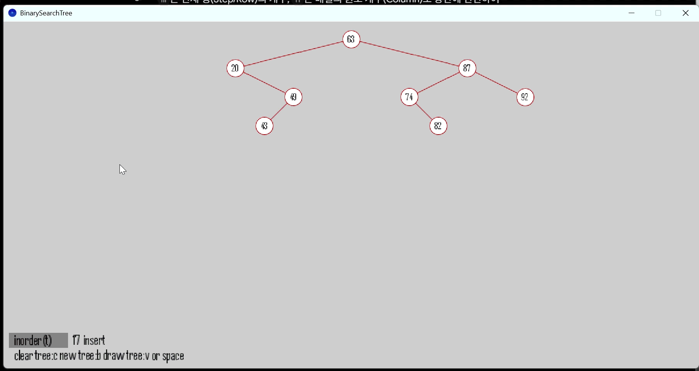

# 🚀 Algorithm 2026

algorithm implementation and visualization archive using Processing.

### ▶ [브라우저에서 바로 실행해 보기 (p5.js 포팅)](https://kitbomin.github.io/projects/algorithms/)

정렬 6종 · 이진 탐색 트리(삽입/삭제/순회 3종) · 동적 계획법(조약돌 놓기, 행렬 경로)을 단계별로 재생할 수 있습니다.
포팅하면서 아래 항목을 보수했습니다.

| 원본 | 보수 내용 |
|---|---|
| `heap_sort.pde` | 파일 이름과 달리 선택 정렬만 구현되어 있음 → 웹 버전에서 최대 힙 기반 힙 정렬을 새로 구현 |
| `SortAnimation.pde` | 퀵 정렬이 주석 처리, 병합 정렬의 병합 단계가 기록되지 않음 → 모든 비교·쓰기 시점을 프레임으로 기록 |
| `BinarySearchTree.pde` | 전위·후위 순회 분기가 비어 있음 → 세 가지 순회 모두 구현 |
| `PebbleSumAlgorithm.pde` | 패턴에 '위+아래'가 빠짐 → 교재 정의의 4패턴(위·가운데·아래·위+아래)으로 수정 |
| `MatrixPath.pde` | 메모 없는 재귀(지수 시간) → 표를 채우는 O(n²) 상향식 DP + 경로 역추적 |

---

### 📌 Implementations

* **1. Selection Sorting**
  * 📄 Source: [`selection_sorting_by_method.pde`](./homework/selection_sorting_by_method.pde)
  

    
출력화면

    
  

* **2. Bubble Sorting**
  * 📄 Source: [`bubble_selection.pde`](./homework/bubble_selection.pde)
  

    
출력화면

    
  

* **3. Insertion Sorting**
  * 📄 Source: [`insertion_sorting.pde`](./homework/insertion_sorting.pde)
  

    
출력화면

    
  

* **4. Merge Sorting**
  * 📄 Source: [`merge_sorting.pde`](./homework/merge_sorting.pde)
  

    
출력화면

    
  

* **5. Quick Sorting**
  * 📄 Source: [`quick_sorting.pde`](./homework/quick_sorting.pde)
  

    
출력화면

    
  

* **6. Heap Sorting**
  * 📄 Source: [`heap_sort.pde`](./homework/heap_sort.pde) — ⚠️ 원본은 선택 정렬로 구현되어 있음. 실제 힙 정렬은 [웹 버전](https://kitbomin.github.io/projects/algorithms/) 참고
  

    
출력화면

    
  

---

### Anime

- **bubble Sorting Anime**
  * 📄 Source: [`SortAnimation.pde`](./homework/SortAnimation.pde)
  * [`SortAnimation/anime-gif.gif`](./SortAnimation/anime-gif.gif)
  

### Tree
- **Binary Search Tree**
  * 📄 Source: [`BinarySearchTree.pde`](./homework/BinarySearchTree.pde)
  * [`B-Tree/b-tree-gif.gif`](./B-Tree/b-tree-gif.gif)
  
  
### Dynamic Programming
* **1. fibo_golden_ratio**
  * 📄 Source: [`fibo_golden_ratio.pde`](./homework/fibo_golden_ratio.pde)
  

    
출력화면

    
  

* **2. PebbleSumAlgorithm**
  * 📄 Source: [`PebbleSumAlgorithm.pde`](./homework/PebbleSumAlgorithm.pde)
  

    
출력화면

    
  

