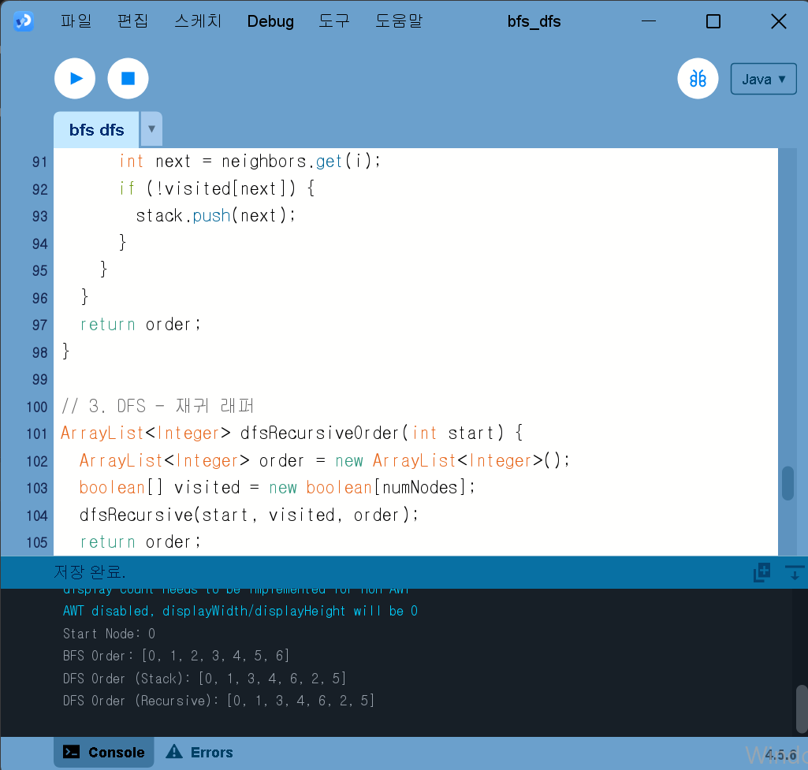
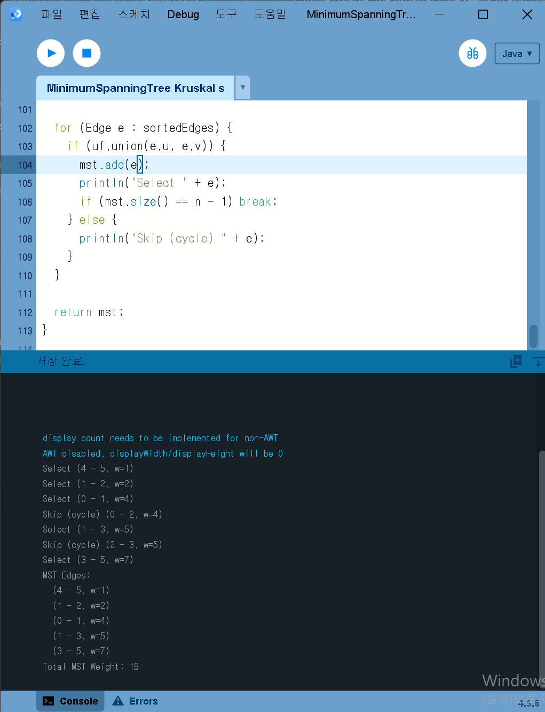
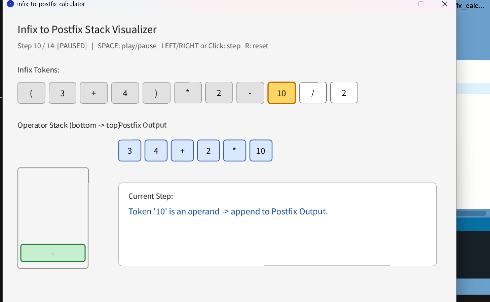

# 🚀 Algorithm 2026
과제 총 정리
https://kitbomin.github.io/projects/algorithms/
---

### 📌 Implementations

* **1. Selection Sorting**
  * 📄 Source: [`selection_sorting_by_method.pde`](./homework/selection_sorting_by_method.pde)
  

    
출력화면

    
  

* **2. Bubble Sorting**
  * 📄 Source: [`bubble_selection.pde`](./homework/bubble_selection.pde)
  

    
출력화면

    
  

* **3. Insertion Sorting**
  * 📄 Source: [`insertion_sorting.pde`](./homework/insertion_sorting.pde)
  

    
출력화면

    
  

* **4. Merge Sorting**
  * 📄 Source: [`merge_sorting.pde`](./homework/merge_sorting.pde)
  

    
출력화면

    
  

* **5. Quick Sorting**
  * 📄 Source: [`quick_sorting.pde`](./homework/quick_sorting.pde)
  

    
출력화면

    
  

* **6. Heap Sorting**
  * 📄 Source: [`heap_sort.pde`](./homework/heap_sort.pde) 
  

    
출력화면

    
  

---

### Anime

- **bubble Sorting Anime**
  * 📄 Source: [`SortAnimation.pde`](./homework/SortAnimation.pde)
  * [`SortAnimation/anime-gif.gif`](./SortAnimation/anime-gif.gif)
  

### Tree
- **Binary Search Tree**
  * 📄 Source: [`BinarySearchTree.pde`](./homework/BinarySearchTree.pde)
  * [`B-Tree/b-tree-gif.gif`](./B-Tree/b-tree-gif.gif)
  
  
### Dynamic Programming
* **1. fibo_golden_ratio**
  * 📄 Source: [`fibo_golden_ratio.pde`](./homework/fibo_golden_ratio.pde)
  

    
출력화면

    
  

* **2. PebbleSumAlgorithm**
  * 📄 Source: [`PebbleSumAlgorithm.pde`](./homework/PebbleSumAlgorithm.pde)
  

    
출력화면

    
  

### Graph
* **1. BFS / DFS**
  * 📄 Source: [`bfs_dfs.pde`](./graph/bfs_dfs/bfs_dfs.pde)
  * 인접 리스트 기반 그래프에서 BFS(큐), DFS(스택·재귀) 방문 순서를 출력
  

    
출력화면

    
  

* **2. Minimum Spanning Tree (Kruskal's)**
  * 📄 Source: [`MinimumSpanningTree_Kruskal_s.pde`](./graph/MinimumSpanningTree_Kruskal_s/MinimumSpanningTree_Kruskal_s.pde)
  * 간선을 가중치 순으로 정렬한 뒤 Union-Find로 사이클을 피하며 최소 신장 트리 구성
  

    
출력화면

    
  

* **3. Infix to Postfix Calculator**
  * 📄 Source: [`infix_to_postfix_calculator.pde`](./graph/infix_to_postfix_calculator/infix_to_postfix_calculator.pde)
  * 스택으로 중위 표기식을 후위 표기식으로 변환하고 계산 (예: `(3 + 4) * 2 - 8 / 4` → `3 4 + 2 * 8 4 / -` = `12`)
  

    
출력화면

    
  

